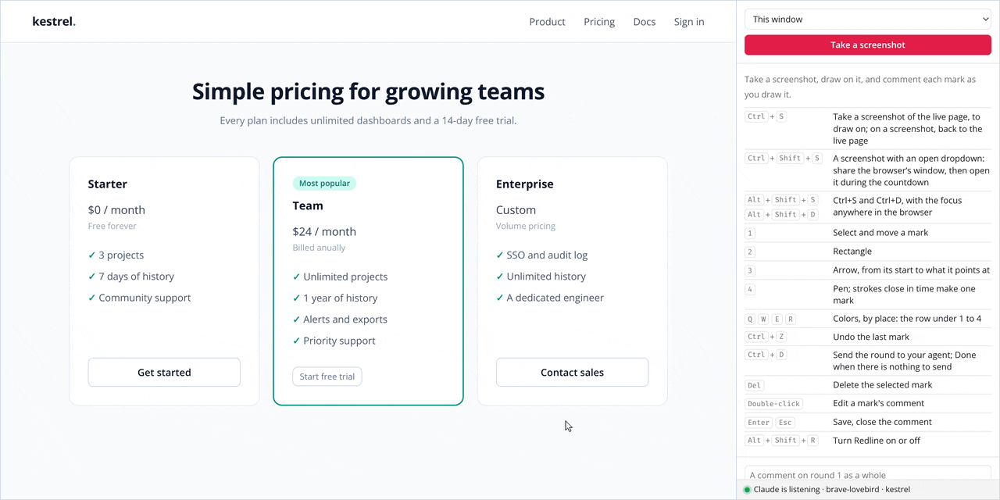
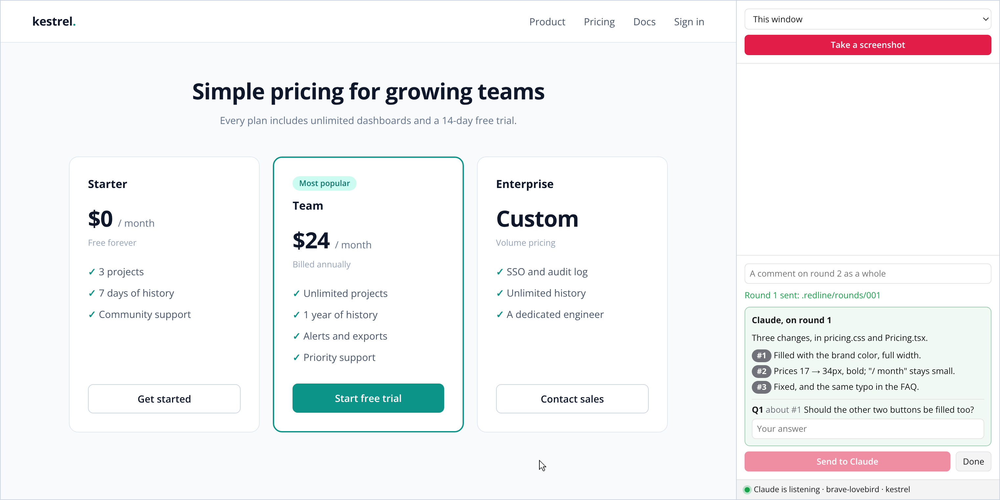

# Redline

**Draw on the page you are building, comment each mark, and your coding agent fixes it.**

[](LICENSE)




hitl-redline (human in the loop) is a browser extension, a small bridge, and a `/redline` skill
for your coding agent: Claude Code, Codex, pi, or [another](docs/agents.md). Your agent opens the
page; you take a screenshot of it, draw on it, and write what to change; it gets each mark with
the element under it, changes the code, replies, and waits for the next round.

## Why

- **Point instead of describe.** "The button at the bottom of the middle card" becomes a rectangle
  around it, numbered `#1`, with your comment.
- **The agent knows what you pointed at.** Each mark comes with its element: a CSS selector, its
  text, and its path in the page; on a Preact page in development, the components that rendered it
  and where their JSX is.
- **A loop, not a one-off.** Round after round, the agent replies in the sidebar (what it did of
  each mark, and its questions), until you click **Done**.
- **Local, and yours only.** The bridge listens on `127.0.0.1` while an agent waits, and every
  request is signed with a token only you can read. Several agent sessions can review at once,
  each on a channel of its own.

## How it works

```
/redline ──▶ your agent opens the preview in the browser, and waits
                │
                ▼
   you take a screenshot: the page freezes under it
   you draw on it:  ▭ rectangles  ➚ arrows  ✎ freehand marks   each one numbered #1, #2…
   you write a comment per mark, as you draw it
   … as many screenshots as you need
                │  Send
                ▼
   the agent reads .redline/<channel>/NNN/, changes the code, reloads the page, and waits again
                │
                └──▶ … until you click Done
```



What your agent gets, in the project:

```
.redline/sleepy-gecko/001/
├─ feedback.md          what the agent reads first: every mark by #id, its comment, its element
├─ feedback.json        all of it, with coordinates
├─ S1.annotated.png     the screenshot with the marks and their #id
└─ S1.clean.png         the same, without
```

```markdown
- **#1** rectangle at (433, 546), 130×54 on `article.plan.featured > button` "Start free trial"

  > Make this the main call to action: filled, full width

- **#2** arrow from (675, 275) pointing at (549, 350) on `article.plan.featured > p.price` "$24 / month"

  > Prices should be the biggest thing on the cards
```

([the whole of it](docs/images/round/feedback.md), and [its screenshot](docs/images/round/S1.annotated.png))

It has three parts:

- **The extension** (`packages/extension`), for Firefox and Chrome. It draws on the page, lists
  the marks in the sidebar, captures the screenshots, and sends each round.
- **The bridge** (`packages/bridge`), `redline`: `redline wait` listens on the loopback for one
  round, writes it to `.redline/<channel>/NNN/`, prints the path of its `feedback.md`, and exits: that
  exit is what tells the agent a round came.
- **The `redline` skill** (`claude/skills/redline`), an [Agent Skill](https://agentskills.io) that
  runs the loop. It comes as a Claude Code plugin, as a skill for Codex, and in a pi package
  (`packages/pi`).

## Quick start

For Claude Code; [docs/install.md](docs/install.md) has the other agents, browsers and systems.

1. **The bridge**, with Nix, or with Node 22.18 or later (then put
   `node …/packages/bridge/dist/redline.mjs` on your `PATH` as `redline`):

   ```sh
   nix profile install github:nitrotm/hitl-redline#redline
   # or
   git clone https://github.com/nitrotm/hitl-redline && cd hitl-redline && yarn install && yarn build
   ```

   In a NixOS or home-manager configuration, it is a flake input: see
   [With Nix](docs/install.md#with-nix).

2. **Pair your browsers**, once: `redline install` makes your token and the native messaging host
   that hands it to the extension.

3. **The extension**: with the firefox-devtools MCP or the Chrome DevTools MCP, your agent installs
   it in the browser it drives, by itself. Otherwise, in Chrome: `chrome://extensions`, **Developer
   mode**, **Load unpacked**, and the directory `redline extension-path chrome` prints (Firefox:
   see [The browser](docs/install.md#the-browser)).

4. **The skill**, in Claude Code:

   ```
   /plugin marketplace add nitrotm/hitl-redline
   /plugin install redline@redline
   ```

5. **Review**: in your project, run `/redline` (or `/redline http://localhost:5173/`), or ask
   your agent to show you the page. Open the sidebar with Redline's toolbar button, press
   <kbd>Ctrl</kbd>+<kbd>S</kbd> on the page, draw, comment, and <kbd>Ctrl</kbd>+<kbd>D</kbd> to send.

## Shortcuts

| Key                                                 | Tool                                                                       |
| --------------------------------------------------- | -------------------------------------------------------------------------- |
| <kbd>Ctrl</kbd>+<kbd>S</kbd>                        | Take a screenshot of the live page; on a screenshot, back to the live page |
| <kbd>1</kbd> <kbd>2</kbd> <kbd>3</kbd> <kbd>4</kbd> | Select, rectangle, arrow, pen                                              |
| <kbd>Q</kbd> <kbd>W</kbd> <kbd>E</kbd> <kbd>R</kbd> | Colors (and the selected mark's)                                           |
| <kbd>Ctrl</kbd>+<kbd>Z</kbd>                        | Undo the last mark                                                         |
| <kbd>Ctrl</kbd>+<kbd>D</kbd>                        | Send to your agent; Done when there is nothing to send                     |

All of them, the devices (phone, tablet…), open dropdowns and the sidebar: [docs/usage.md](docs/usage.md).

## Documentation

- [Install](docs/install.md): Nix or Node, pairing, each agent, each browser, an agent's sandbox,
  platforms and networks.
- [Use](docs/usage.md): screenshots, marks, devices, the sidebar, the rounds, several agent
  sessions at once.
- [Security](docs/security.md): what listens, what it writes, and what it relies on.
- [For agents](docs/agents.md): the commands, their exit codes, the files, the reply.

## Develop

```sh
direnv allow        # or: nix develop
yarn install
yarn dev            # WXT: builds the Firefox extension on each change, in packages/extension/.output/firefox-mv2
yarn build          # both browsers
yarn test           # unit tests and the bridge's
yarn test:e2e:chrome
yarn test:e2e:firefox
yarn lint
yarn shots          # the README's pictures, after yarn build
nix flake check     # the build of the flake, with the type check and the tests
```

In the dev shell, `redline` runs the bridge from its sources, and `redline extension-path`
points at `packages/extension/.output/firefox-mv2`. To try it by hand: `node e2e-fixtures/serve.mjs`
serves a test page on `http://127.0.0.1:47380/`, and `redline wait --url http://127.0.0.1:47380/`
makes Redline start there by itself. [AGENTS.md](AGENTS.md) has how the code is laid out.

## License

[MIT](LICENSE).

Written by Antony Ducommun, co-authored with [Claude Code](https://claude.com/claude-code).
